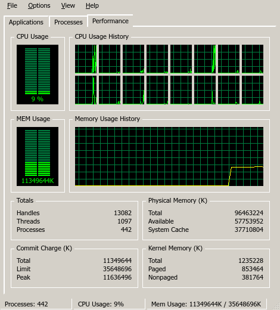
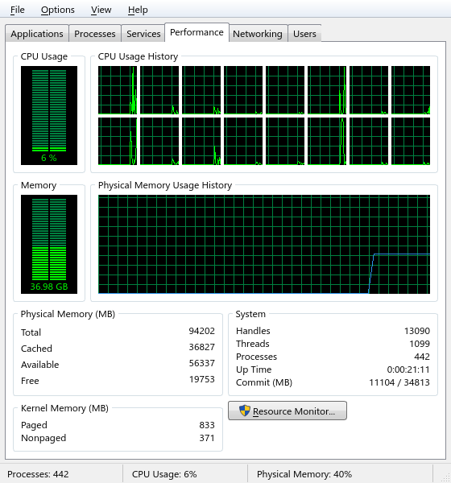
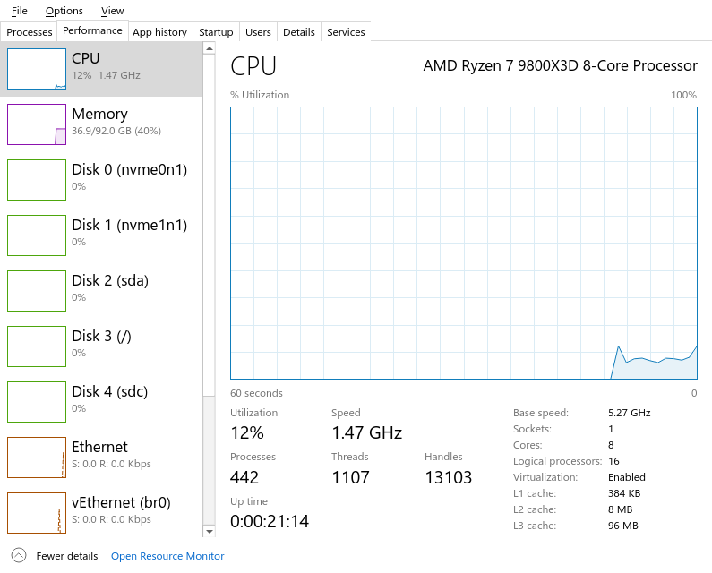
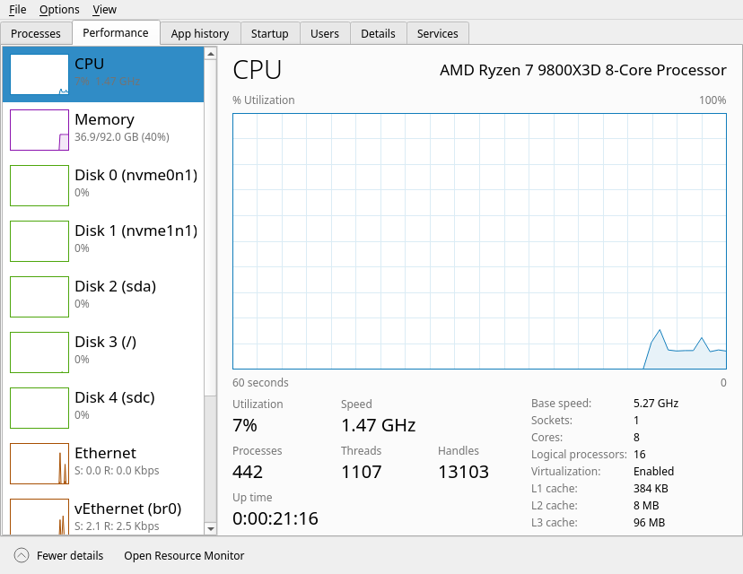

# KDE Task Manager

A task manager for KDE Plasma that looks and works like the Windows one, in four styles: Windows 2000,
Windows 7, Windows 10, and KDE Native (the Windows 10 layout drawn with your Plasma theme, colours and font).
It also adds **Task Manager** to the panel's right-click menu, like the Windows taskbar.

| Windows 2000 | Windows 7 |
|---|---|
|  |  |
| **Windows 10** | **KDE Native** |
|  |  |

Switch styles under **Options › Style**.

## Install

### Arch Linux

The PKGBUILD is in `packaging/arch/`:

```sh
cd packaging/arch && makepkg -si
ktaskmanager-enable-panel-menu   # optional: adds Task Manager to the panel's right-click menu
```

### From source

You need Python 3 with PyQt6 and psutil, plus cmake, a C++ compiler and the Qt 6, KF6 (Config, CoreAddons)
and libplasma development files for the panel menu plugin.

```sh
./install.sh
```

This builds the plugin, installs everything under `/usr` with `sudo`, and turns on the panel menu.
Turning it on means editing `~/.config/plasma-org.kde.plasma.desktop-appletsrc` and restarting `plasmashell`.

### Optional extras

| Program | Adds |
|---|---|
| `nvidia-smi` | NVIDIA GPU usage, overall and per process |
| `ksgrd_network_helper` (libksysguard) | Per-process network usage |
| `plasma-systemmonitor` | The "Resource Monitor" button |
| `qdbus6` | The Log off / Sign out button on the Users tab |
| `pacman` | The Publisher column (the package that owns each program) |

Without them, those columns stay blank and those buttons do nothing. Everything else still works.

## Uninstall

```sh
ktaskmanager-enable-panel-menu --disable   # restore the stock panel menu first
sudo pacman -R ktaskmanager                # Arch package
sudo xargs rm < plugin/build/install_manifest.txt   # or, if installed with install.sh
```

## License

GPL-2.0-or-later. See [LICENSE](LICENSE).

Not affiliated with or endorsed by Microsoft. "Windows" is used only to describe which look each style copies.
